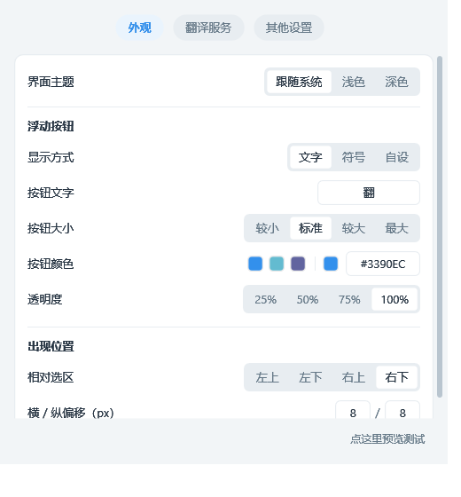
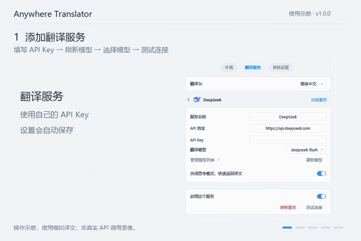

<h1>Anywhere Translator</h1>

Windows 全局划词翻译：选中文字 → 点击按钮 → 查看译文。不局限于浏览器。

当前版本为 v1.3.1，支持中文／English 界面与即时切换，同时提供 Setup 安装版和 Portable ZIP 便携版，两者均不内置 .NET 或 WebView2。

English UI is available in **Appearance → Language → English**. System mode uses Chinese for Chinese system languages and English otherwise. Install .NET 10 Desktop Runtime (x64), run the EXE, then add your provider and API key in **Translation**.

[下载 Setup 安装版（推荐）](https://github.com/gitkukara/anywhere-translator/releases/download/v1.3.1/Anywhere-Translator-v1.3.1-win-x64-Setup.exe) · [下载 Portable ZIP](https://github.com/gitkukara/anywhere-translator/releases/download/v1.3.1/Anywhere-Translator-v1.3.1-win-x64-portable.zip) · [发布页面与 SHA256 校验文件](https://github.com/gitkukara/anywhere-translator/releases/tag/v1.3.1) · [更新说明](RELEASE_NOTES.md)

## 特色

- 支持多种 API 接入： DeepSeek、智谱 GLM、小米 MiMo、千问 Qwen、OpenAI、Gemini ，还可自定义接口，API Key 在本机加密保存；
- 支持界面浅色、深色及跟随系统；
- 界面语言支持跟随系统、English、中文，立即生效并自动保存；与翻译目标语言独立。
- 译文支持 Markdown 与 LaTeX 数学公式排版，适合论文阅读；
- 支持自定义翻译按钮的样式与出现位置；
- 支持开机自启动；
- 单个 EXE，无需解压或随附 DLL、字体、脚本；需要系统已安装 .NET 10 Desktop Runtime（x64）。

## 使用

| 版本 | Setup 安装版（推荐） | Portable ZIP 便携版 |
| --- | --- | --- |
| 开始使用 | 运行安装向导 | 完整解压后运行 EXE |
| 运行环境 | 检测缺失项，提供微软下载入口，安装后重新检测 | 自行安装 .NET 10 Desktop Runtime（x64）和 WebView2 |
| 设置位置 | `%LOCALAPPDATA%\AnywhereTranslator\data` | 程序旁的 `data` |
| 快捷方式 | 创建开始菜单入口，可选桌面快捷方式 | 不自动创建，可自行创建 |
| 卸载 | Windows“已安装的应用”，保留用户数据 | 退出后删除程序文件夹 |

两种版本均不内置运行时，附中英文说明：[安装版 / Setup guide](docs/INSTALL.txt)、[便携版 / Portable guide](docs/PORTABLE.txt)。跨电脑或 Windows 用户通常需要重新填写 API Key。安装版与便携版的数据目录不同，不要同时运行两个副本；迁移步骤见说明。

1. **安装版**：运行 `Anywhere-Translator-v1.3.1-win-x64-Setup.exe`，按向导安装。缺失运行环境时，点击下载按钮，在微软网站安装后返回向导重新检测；已有运行时无需重复安装。默认安装到当前用户的 `%LOCALAPPDATA%\Programs\Anywhere Translator`，之后从开始菜单启动。
   **便携版**：安装 [.NET 10 Desktop Runtime（x64）](https://dotnet.microsoft.com/en-us/download/dotnet/10.0) 和 [WebView2 Runtime](https://developer.microsoft.com/en-us/microsoft-edge/webview2/)，将 Portable ZIP 完整解压到可写入目录，运行 `Anywhere Translator.exe`。不要直接在压缩包内运行；程序不会自动创建快捷方式。
2. 在“翻译服务”添加供应商，填写 API Key，刷新并选择模型，测试连接后设为当前服务。
3. 在其他应用中拖选文字，点击选区附近出现的按钮，弹出浮窗显示翻译；也可选中文字后按 `Ctrl+Alt+T`。
4. 点击翻译浮窗外部即可收起，钉住后保持显示。

在“外观”中切换界面主题、调整按钮样式和位置；右下角“点这里预览测试”可打开测试文字窗口。

“外观”顶部的“语言”采用分段按钮：跟随系统／English／中文。切换后设置、服务管理、托盘和翻译浮窗提示立即更新，无需重启。中文系统使用中文，其余系统语言使用英文；已有的翻译目标语言、模型和自定义文字不会随界面语言改变。

“其他设置”页底部可查看当前程序版本号。

浮动按钮选择“自设”后可导入透明 PNG 或静态 SVG，只显示图片本身，不附加底色、边框或阴影。图片按原比例缩放，大小和透明度仍可调整；JPG 等图片自带的背景会保留。

“导入”左侧显示最近三个导入图标的缩略图，固定为 24 × 24 逻辑像素，按原比例居中缩放，点击即可切换，选中的图标有描边提示。记录在重启后保留，没有导入记录时不显示缩略图。

**Zotero 取词**：在“其他设置”开启“兼容应用自动复制取词”，并在“兼容名单”填写 `zotero`。该方式会模拟复制来读取选中文字。

**使用演示（视频由AI制作，实际体验更丝滑）：**

## 更新

目前需要手动更新。已有版本的用户按以下步骤操作，首次安装直接看上方“使用”即可。

1. **退出旧程序**：在 Windows 任务栏右下角找到 Anywhere Translator 图标（可能藏在“∧”里），右键选择“退出”。只关闭设置窗口不会退出程序。
2. **下载新版**：从[最新版本页面](https://github.com/gitkukara/anywhere-translator/releases/latest) 下载与你当前发行方式一致的 Setup EXE 或 Portable ZIP，不要下载 `Source code`。
3. **备份数据**：安装版备份 `%LOCALAPPDATA%\AnywhereTranslator\data`；便携版备份原程序旁的 `data`。其中保存了设置、图标和加密后的 API Key。
4. **安装更新**：安装版运行新版 Setup；便携版将解压得到的 `Anywhere Translator.exe` 复制到原目录替换同名文件，保留原来的 `data` 文件夹。旧版本的 DLL、运行时及 `Assets` 文件夹不再需要，可在备份后清理；首次升级无需删除它们也能运行。
   从 v1.1.2 或更早版本升级后，可删除原目录中遗留的 `TranslatorAnywhere.exe`，以后使用新名称启动。
5. **重新启动**：双击原目录中的 `Anywhere Translator.exe`。在同一台电脑、同一个 Windows 用户账户下，原有设置和 API Key 会继续使用，通常不需要重新填写。

例如：便携版位于 `D:\Apps\AnywhereTranslator\`，就只替换其中的 `Anywhere Translator.exe`，保留 `D:\Apps\AnywhereTranslator\data\`。改用安装版时请按[迁移说明](docs/INSTALL.txt)复制数据，而不是直接混合两个程序目录。

如果提示文件正在使用，先确认已从托盘退出程序，再重试。若改用了新的程序目录，需要把旧 `data` 文件夹一起复制过去；启用过开机启动的用户，还应在新程序中关闭再开启“开机静默启动”，更新启动路径。

**图标说明**：如果 `data` 中有自定义的 `app.ico`，升级后仍优先使用它。想换回新版内置图标，可以退出程序后将它改名为 `app.ico.bak`，再启动程序。

**使用限制**：图片、扫描 PDF 暂不支持 OCR；部分应用可能需要兼容取词设置。Zotero 已在本机验证可用，福昕 PDF 编辑器兼容问题仍待完善。

**论文与公式**：译文支持标题、列表、表格、代码和常见数学公式，包括行内公式、独立公式及多行对齐。长公式和宽表格可横向滚动，复制按钮保留 Markdown / LaTeX 源文本。渲染库及字体内嵌在 EXE，排版无需联网；需要 Microsoft Edge WebView2 Runtime，缺失或加载失败时自动显示源文本。若 PDF 复制时已经丢失上下标、分数结构或符号，程序无法保证恢复原公式；不支持的 LaTeX 命令会保留为文本。

## 开发

安装 .NET 10 SDK 后运行 `dotnet build TranslatorAnywhere.slnx -c Release`。

生成发行包：先运行 `pwsh -File scripts/build.ps1 -SkipDeploy`，再运行 `pwsh -File scripts/package-portable.ps1` 和 `pwsh -File scripts/package-setup.ps1 -CompilerPath "C:\path\to\Inno Setup 6\ISCC.exe"`。Setup 打包需要 Inno Setup 6；两个脚本均生成 SHA256 文件，不修改本地正在使用的程序。安装版通过随包的 `installed-mode` 标记选择 AppData，便携包不包含该标记。

[MIT](LICENSE) · [第三方图标授权](THIRD-PARTY-NOTICES.md)
